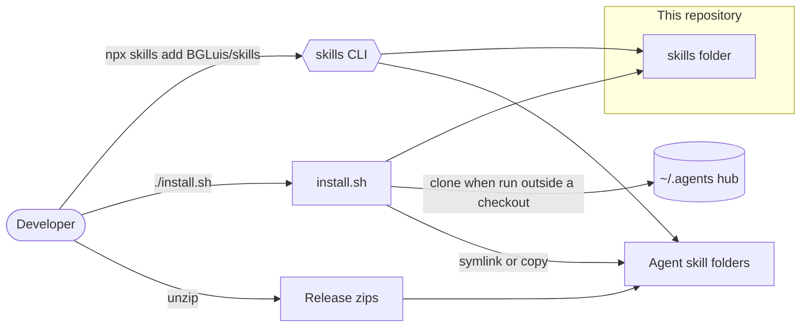
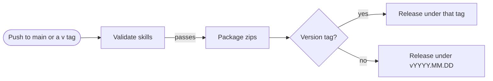

# Architecture

<!-- Example: the opening of an ARCHITECTURE.md for this repository (BGLuis/skills). Anchors
point at directories and symbols, not lines, because this file is updated rarely. Validate with:
python3 skills/technical-diagrams/scripts/validate_diagrams.py --repo-root . --render \
  skills/technical-diagrams/examples/architecture-md.md -->

## Bird's-eye view

The repository is a collection of Agent Skills: each folder under `skills/` is one skill, a
`SKILL.md` plus its references and scripts. Nothing here runs as a service. A skill reaches an
agent in one of three ways, and every push to `main` validates the skills and publishes them as a
GitHub release.

The figure shows those three paths, from the developer to the folder the agent reads.

## Codemap

- `skills/<name>/` — one skill. `SKILL.md` is the entry point; long material lives in
  `references/`, deterministic checks in `scripts/` with their tests in `scripts/tests/`.
- `install.sh` — the installer: picks the source folder, resolves `skill_deps`, and links each skill
  into every agent folder it finds (`install_to_agent`).
- `.github/workflows/` — `validate-skills.yml` checks every skill; `release.yml` reuses it, then
  packages and publishes.

The release pipeline, which only maintainers touch. A version tag publishes a release under that
tag; any other push to `main` gets a dated tag, with a counter when the date is already taken.

## Invariants

- A skill's folder name equals the `name` in its `SKILL.md`; `validate_skills.py` fails otherwise.
- `skill_deps` is not transitive: a skill that needs another lists every skill it reaches.
