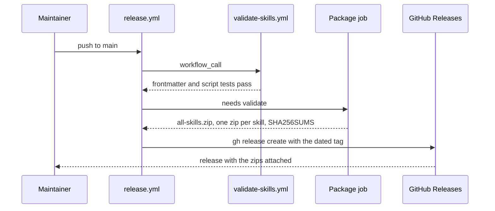

<!-- Example: section 4 of a mode C (post-implementation) report written with the technical-report
skill, about commit ba7913c of this repository ("automate release creation on push to main"). Only
this section is shown. The figure answers "who calls whom, in what order", so it is a sequence
diagram; the anchors carry line numbers like every other claim in the report. -->

## 4. Implementation details

### 4.1 Release reuses the validation workflow instead of copying it

`release.yml` calls `validate-skills.yml` as a reusable workflow (`release.yml:21-25`), so a release
can only be cut from a commit that passes the same checks as a pull request. Packaging waits on
validation (`needs: validate`, `release.yml:29`) and publishing waits on packaging
(`needs: package`, `release.yml:51`).

The tag is chosen at the last step: a pushed version tag is released as is, any other push to
`main` gets a dated tag with a counter (`release.yml:68-80`).

A failing validation stops the run before `package`; no partial release is published, because
`release` depends on `package`, which depends on `validate`.
